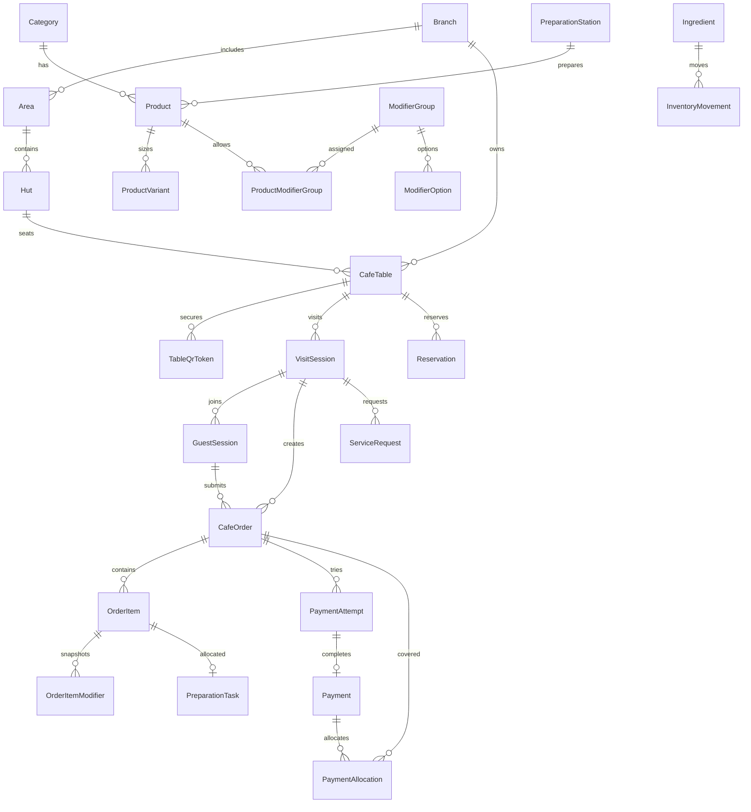
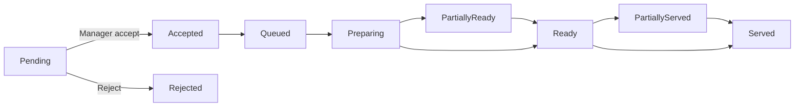

# ERD rút gọn — MVP

Các entity EF Core trong `backend/MocCafe.Api/Domain/Entities.cs`; mapping precision, unique index, rowversion trong `Data/CafeDbContext.cs`. SQL Server sinh bảng qua EF migration do `scripts/setup-windows.ps1` tạo ở lần khởi tạo đầu tiên.

## Trạng thái

Thanh toán **độc lập** với pha chế: `Unpaid/Pending → Paid` (hoặc `Failed` ở PaymentAttempt demo), không tự phục vụ món khi đã Paid.

## Giới hạn kiến trúc cần khắc phục

- Reservation dùng SQL Server Serializable transaction và index (chưa test stress/phantom).
- Đơn giá có snapshot nhưng chưa khóa quote server trong thời gian ngắn và chưa áp dụng khuyến mãi.
- Outbox worker hiện xử lý một instance, chưa có claim/lease lock cho nhiều backend nodes.
- Không có công thức/giá vốn và số dư thanh toán một phần.
